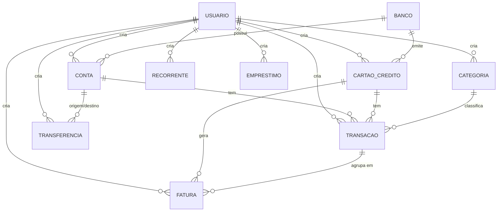

# Database Schema

SQLite database with 11 core entities. **File:** `ControleFinanceiro.Api/controlefinanceiro.db`

## Entity Relationship Diagram



---

## Tables

### USUARIOS
Usuários do sistema. Autenticação via JWT.

| Coluna | Tipo | Constraints | Descrição |
|--------|------|-------------|-----------|
| `Id` | UUID | PK | Chave primária |
| `Email` | TEXT | UNIQUE NOT NULL | Email único para login |
| `Nome` | TEXT | NOT NULL | Nome completo |
| `SenhaHash` | TEXT | NOT NULL | BCrypt hash da senha |
| `DataNascimento` | DateTime | NULL | Opcional |
| `DataCriacao` | DateTime | NOT NULL | Timestamp de criação |
| `DataAtualizacao` | DateTime | NOT NULL | Timestamp de atualização |

**Delete Behavior:** RESTRICT (não pode deletar se tem contas/cartões/etc)

---

### CONTAS
Contas bancárias e carteiras do usuário.

| Coluna | Tipo | Constraints | Descrição |
|--------|------|-------------|-----------|
| `Id` | UUID | PK | |
| `UsuarioId` | UUID | FK(Usuarios) NOT NULL | Isolamento de dados |
| `BancoId` | UUID | FK(Bancos) | Banco da conta |
| `Nome` | TEXT | NOT NULL | Ex: "Conta Corrente Itaú" |
| `Tipo` | INT | NOT NULL | 0=Corrente, 1=Poupança, 2=Carteira |
| `NumeroConta` | TEXT | NULL | Número da conta |
| `IsCarteira` | BOOL | DEFAULT 0 | Carteira padrão do user |
| `DataCriacao` | DateTime | NOT NULL | |

**Saldo:** Calculado dinamicamente como `SUM(Receitas) - SUM(Despesas)`

**Delete Behavior:** Contas com transações → RESTRICT

---

### BANCOS
Bancos do Brasil. Sincronizados com BCB (Banco Central do Brasil) API.

| Coluna | Tipo | Constraints | Descrição |
|--------|------|-------------|-----------|
| `Id` | UUID | PK | |
| `Codigo` | INT | UNIQUE NOT NULL | Código BCB (Ex: 001 = BB) |
| `Nome` | TEXT | NOT NULL | Ex: "Banco do Brasil" |
| `Ispb` | TEXT | NOT NULL | Identificador ISPB |
| `Url` | TEXT | NULL | Website do banco |

**Sincronização:** `BancoSeeder.cs` faz fetch no init do app.

---

### CARTOES_CREDITO
Cartões de crédito do usuário.

| Coluna | Tipo | Constraints | Descrição |
|--------|------|-------------|-----------|
| `Id` | UUID | PK | |
| `UsuarioId` | UUID | FK(Usuarios) NOT NULL | |
| `BancoId` | UUID | FK(Bancos) | Banco emissor |
| `Nome` | TEXT | NOT NULL | Ex: "Visa Platinum" |
| `Bandeira` | INT | NOT NULL | 0=Visa, 1=Mastercard, 2=Amex, 3=Elo |
| `Limite` | DECIMAL | NOT NULL | Limite de crédito |
| `DataVencimento` | INT | NOT NULL | Dia do mês (1-31) |
| `DataCriacao` | DateTime | NOT NULL | |

**Delete Behavior:** Faturas abertas → RESTRICT

---

### TRANSACOES
Movimentações financeiras. Core entity.

| Coluna | Tipo | Constraints | Descrição |
|--------|------|-------------|-----------|
| `Id` | UUID | PK | |
| `UsuarioId` | UUID | FK(Usuarios) NOT NULL | |
| `ContaId` | UUID | FK(Contas) | NULL se CartãoCredito |
| `CartaoCreditoId` | UUID | FK(CartoesCreditito) | NULL se Conta |
| `CategoriaId` | UUID | FK(Categorias) | NULL = sem categoria |
| `FaturaId` | UUID | FK(Faturas) | Apenas se CartãoCredito |
| `Descricao` | TEXT | NOT NULL | Até 400 chars |
| `Valor` | DECIMAL | NOT NULL | Sempre positivo |
| `Tipo` | INT | NOT NULL | 0=Receita, 1=Despesa |
| `MeioPagamento` | INT | NULL | 0=Dinheiro, 1=Débito, 2=Crédito, 3=TED, 4=PIX |
| `UsadoComoCredito` | BOOL | DEFAULT 0 | Se receita foi creditada |
| `Parcelas` | INT | NULL | Total de parcelas (se parcelado) |
| `NumeroParcela` | INT | NULL | Número desta parcela (1..N) |
| `Data` | DateTime | NOT NULL | Quando a transação ocorreu |
| `DataCriacao` | DateTime | NOT NULL | |

**Parcelamento:**
- Criar 1 transação com `Parcelas=12` gera 12 linhas na tabela
- Cada uma tem `NumeroParcela` (1, 2, ..., 12)
- Todas linkadas à mesma `FaturaId`

**Constraints:**
- `ContaId XOR CartaoCreditoId` — nunca ambos NULL ou ambos preenchidos
- Se `CartaoCreditoId` → auto-cria/atualiza `Fatura`

---

### CATEGORIAS
Categorias de despesas/receitas.

| Coluna | Tipo | Constraints | Descrição |
|--------|------|-------------|-----------|
| `Id` | UUID | PK | |
| `UsuarioId` | UUID | FK(Usuarios) NOT NULL | |
| `Nome` | TEXT | NOT NULL | Ex: "Alimentação" |
| `Finalidade` | INT | NOT NULL | 0=Despesa, 1=Receita, 2=Ambas |
| `SaldoInicial` | DECIMAL | NULL | Deprecated (was optional) |
| `DataCriacao` | DateTime | NOT NULL | |

**Validação:** Ao criar transação, validar que `Categoria.Finalidade` é compatível com `Transacao.Tipo`

---

### FATURAS
Faturas de cartão de crédito. Auto-criadas.

| Coluna | Tipo | Constraints | Descrição |
|--------|------|-------------|-----------|
| `Id` | UUID | PK | |
| `UsuarioId` | UUID | FK(Usuarios) NOT NULL | |
| `CartaoCreditoId` | UUID | FK(CartoesCreditito) NOT NULL | |
| `MesReferencia` | TEXT | NOT NULL | Format: "2026-05" |
| `Status` | INT | NOT NULL | 0=Aberta, 1=Fechada, 2=Paga |
| `DataVencimento` | DateTime | NOT NULL | Calculada: 1º dia do mês + dias úteis |
| `DataPagamento` | DateTime | NULL | Quando foi paga |
| `DataCriacao` | DateTime | NOT NULL | |

**Fluxo:**
1. User cria transação com CartãoCredito → auto-cria Fatura (se não existe)
2. Transação é linkada a Fatura
3. User pode pagar Fatura → Status muda para "Paga"

**Delete Behavior:** RESTRICT (não pode deletar CartãoCredito com Faturas abertas)

---

### TRANSFERENCIAS
Transferências entre contas do user.

| Coluna | Tipo | Constraints | Descrição |
|--------|------|-------------|-----------|
| `Id` | UUID | PK | |
| `UsuarioId` | UUID | FK(Usuarios) NOT NULL | |
| `ContaOrigemId` | UUID | FK(Contas) NOT NULL | De onde |
| `ContaDestinoId` | UUID | FK(Contas) NOT NULL | Para onde |
| `Valor` | DECIMAL | NOT NULL | > 0 |
| `Descricao` | TEXT | NULL | |
| `Data` | DateTime | NOT NULL | |
| `DataCriacao` | DateTime | NOT NULL | |

**Contabilização:**
- Cria 2 transações implícitas:
  - Despesa na ContaOrigem
  - Receita na ContaDestino

---

### RECORRENTES (Assinaturas)
Despesas/receitas que se repetem.

| Coluna | Tipo | Constraints | Descrição |
|--------|------|-------------|-----------|
| `Id` | UUID | PK | |
| `UsuarioId` | UUID | FK(Usuarios) NOT NULL | |
| `ContaId` | UUID | FK(Contas) | NULL se CartãoCredito |
| `CartaoCreditoId` | UUID | FK(CartoesCreditito) | NULL se Conta |
| `CategoriaId` | UUID | FK(Categorias) | |
| `Nome` | TEXT | NOT NULL | Ex: "Netflix" |
| `Valor` | DECIMAL | NOT NULL | |
| `Tipo` | INT | NOT NULL | 0=Receita, 1=Despesa |
| `Frequencia` | INT | NOT NULL | 0=Diária, 1=Semanal, 2=Mensal, 3=Anual |
| `DataProxima` | DateTime | NOT NULL | Próxima execução |
| `Ativa` | BOOL | DEFAULT 1 | |
| `DataCriacao` | DateTime | NOT NULL | |

**Job:** Background job (não implementado) deveria executar recorrentes na data.

---

### EMPRESTIMOS
Registro de empréstimos.

| Coluna | Tipo | Constraints | Descrição |
|--------|------|-------------|-----------|
| `Id` | UUID | PK | |
| `UsuarioId` | UUID | FK(Usuarios) NOT NULL | |
| `ContaId` | UUID | FK(Contas) | Conta que recebeu |
| `Nome` | TEXT | NOT NULL | "Empréstimo João" |
| `Valor` | DECIMAL | NOT NULL | Montante total |
| `TaxaJuro` | DECIMAL | NULL | % a.m. |
| `Tipo` | INT | NOT NULL | 0=Contraído, 1=Concedido |
| `DataInicio` | DateTime | NOT NULL | |
| `DataVencimento` | DateTime | NULL | |
| `Status` | INT | NOT NULL | 0=Ativo, 1=Encerrado, 2=Quitado |
| `DataCriacao` | DateTime | NOT NULL | |

**Notas:** Apenas registro; transações de amortização são criadas manualmente como Transacoes.

---

## Migration Strategy

Migrations estão em `Migrations/` com timestamp:
- `20260303175437_InitialCreate.cs` — Schema base
- `20260427181311_AddDataToTransacao.cs` — Adiciona coluna `Data`
- `20260502182837_AddCartaoCredito.cs` — Nova entidade CartãoCredito
- etc.

**Apply migrations:**
```powershell
dotnet ef database update
```

**Create migration:**
```powershell
dotnet ef migrations add AddNewColumn
```

---

## Índices

Recomendados (não necessariamente implementados):

```sql
CREATE INDEX idx_usuarios_email ON usuarios(email);
CREATE INDEX idx_contas_usuario ON contas(usuario_id);
CREATE INDEX idx_transacoes_usuario ON transacoes(usuario_id);
CREATE INDEX idx_transacoes_data ON transacoes(data);
CREATE INDEX idx_faturas_cartao ON faturas(cartao_credito_id);
CREATE INDEX idx_faturas_status ON faturas(status);
```

---

## Notes

- **Data Isolation:** Todos queries filtram por `UsuarioId`
- **Soft Deletes:** Não implementado (usar RESTRICT delete behavior)
- **Timestamps:** Sempre UTC
- **Decimals:** DECIMAL(18, 2) para valores monetários
- **Saldo calculado:** Não armazenado em `Contas.saldo`; computed on-the-fly
