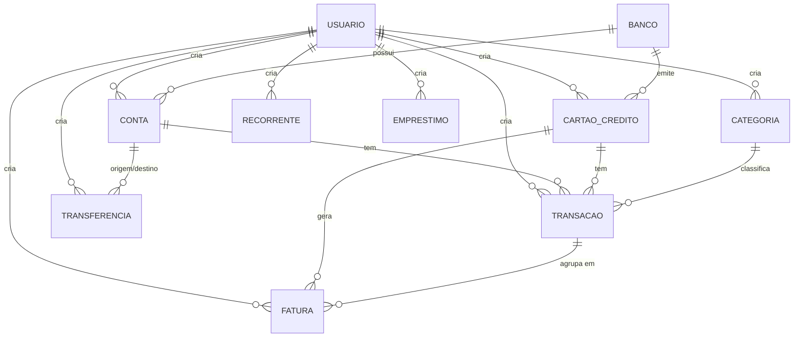

# Database Schema

SQLite database with 11 core entities. **File:** `ControleFinanceiro.Api/controlefinanceiro.db`

## Entity Relationship Diagram



---

## Tables

### USUARIOS
Usuários do sistema. Autenticação via JWT.

| Coluna | Tipo | Constraints | Descrição |
|--------|------|-------------|-----------|
| `Id` | UUID | PK | Chave primária |
| `Email` | TEXT | UNIQUE NOT NULL | Email único para login |
| `Nome` | TEXT | NOT NULL | Nome completo |
| `SenhaHash` | TEXT | NOT NULL | BCrypt hash da senha |
| `DataNascimento` | DateTime | NULL | Opcional |
| `DataCriacao` | DateTime | NOT NULL | Timestamp de criação |
| `DataAtualizacao` | DateTime | NOT NULL | Timestamp de atualização |

**Delete Behavior:** RESTRICT (não pode deletar se tem contas/cartões/etc)

---

### CONTAS
Contas bancárias e carteiras do usuário.

| Coluna | Tipo | Constraints | Descrição |
|--------|------|-------------|-----------|
| `Id` | UUID | PK | |
| `UsuarioId` | UUID | FK(Usuarios) NOT NULL | Isolamento de dados |
| `BancoId` | UUID | FK(Bancos) | Banco da conta |
| `Nome` | TEXT | NOT NULL | Ex: "Conta Corrente Itaú" |
| `Tipo` | INT | NOT NULL | 0=Corrente, 1=Poupança, 2=Carteira |
| `NumeroConta` | TEXT | NULL | Número da conta |
| `IsCarteira` | BOOL | DEFAULT 0 | Carteira padrão do user |
| `DataCriacao` | DateTime | NOT NULL | |

**Saldo:** Calculado dinamicamente como `SUM(Receitas) - SUM(Despesas)`

**Delete Behavior:** Contas com transações → RESTRICT

---

### BANCOS
Bancos do Brasil. Sincronizados com BCB (Banco Central do Brasil) API.

| Coluna | Tipo | Constraints | Descrição |
|--------|------|-------------|-----------|
| `Id` | UUID | PK | |
| `Codigo` | INT | UNIQUE NOT NULL | Código BCB (Ex: 001 = BB) |
| `Nome` | TEXT | NOT NULL | Ex: "Banco do Brasil" |
| `Ispb` | TEXT | NOT NULL | Identificador ISPB |
| `Url` | TEXT | NULL | Website do banco |

**Sincronização:** `BancoSeeder.cs` faz fetch no init do app.

---

### CARTOES_CREDITO
Cartões de crédito do usuário.

| Coluna | Tipo | Constraints | Descrição |
|--------|------|-------------|-----------|
| `Id` | UUID | PK | |
| `UsuarioId` | UUID | FK(Usuarios) NOT NULL | |
| `BancoId` | UUID | FK(Bancos) | Banco emissor |
| `Nome` | TEXT | NOT NULL | Ex: "Visa Platinum" |
| `Bandeira` | INT | NOT NULL | 0=Visa, 1=Mastercard, 2=Amex, 3=Elo |
| `LimiteTotal` | DECIMAL | NOT NULL | Limite total de crédito (ETAPA 5a) |
| `DataVencimento` | INT | NOT NULL | Dia do mês (1-31) |
| `DataCriacao` | DateTime | NOT NULL | |

**Delete Behavior:** Parcelamentos ativos → RESTRICT; Faturas abertas → RESTRICT

**Limits (Calculated):**
- `LimiteBloqueado` = SUM(ValorBloqueado de todos Parcelamentos.Ativo)
- `LimiteDisponivel` = LimiteTotal - LimiteBloqueado

---

### TRANSACOES
Movimentações financeiras. Core entity.

| Coluna | Tipo | Constraints | Descrição |
|--------|------|-------------|-----------|
| `Id` | UUID | PK | |
| `UsuarioId` | UUID | FK(Usuarios) NOT NULL | |
| `ContaId` | UUID | FK(Contas) | NULL se CartãoCredito |
| `CartaoCreditoId` | UUID | FK(CartoesCreditito) | NULL se Conta |
| `CategoriaId` | UUID | FK(Categorias) | NULL = sem categoria |
| `FaturaId` | UUID | FK(Faturas) | Para transações diretas do cartão |
| `ParcelamentoId` | UUID | FK(Parcelamentos) | Se é parte de parcelamento (ETAPA 2) |
| `ParcelaTransacaoId` | UUID | FK(ParcelasTransacao) | Ref bidirecional pra parcela individual |
| `FaturaPagaId` | UUID | FK(Faturas) | Se é pagamento antecipado de parcela |
| `Descricao` | TEXT | NOT NULL | Até 400 chars |
| `Valor` | DECIMAL | NOT NULL | Sempre positivo |
| `Tipo` | INT | NOT NULL | 0=Receita, 1=Despesa |
| `MeioPagamento` | INT | NULL | 0=Dinheiro, 1=Débito, 2=Crédito, 3=TED, 4=PIX |
| `UsadoComoCredito` | BOOL | DEFAULT 0 | Se receita foi creditada |
| `StatusTransacao` | INT | DEFAULT 1 | 0=Previsao, 1=Executado (ETAPA 2) |
| `EhPagamentoFatura` | BOOL | DEFAULT 0 | Pagamento de fatura (usa `FaturaPagaId`, não `FaturaId`) — fora do P&L |
| `EhTransferencia` | BOOL | DEFAULT 0 | Perna de transferência entre contas — fora do P&L (#128) |
| `EhSaldoInicial` | BOOL | DEFAULT 0 | Saldo de abertura de conta — fora do P&L (#128) |
| `EhAjusteReconciliacao` | BOOL | DEFAULT 0 | Ajuste criado por marco de reconciliação — corrige o saldo, fora do P&L |
| `EhPixNoCredito` | BOOL | DEFAULT 0 | Perna do Pix no Crédito na conta (a entrada do cartão ou o Pix que ela pagou) — marcada pela importação; fora do P&L |
| `Ativo` | BOOL | DEFAULT 1 | Soft delete flag (ETAPA 2) |
| `CanceladoEm` | DateTime | NULL | Data do soft delete |
| `MotivoCancelamento` | TEXT | NULL | Razão do soft delete |
| `Data` | DateTime | NOT NULL | Quando a transação ocorreu |
| `CriadoEm` | DateTime | NOT NULL | Timestamp de criação |

> **Saldo ≠ Relatório de P&L (#128):** o **saldo** da conta conta TODO movimento real (`Ativo` + `StatusTransacao=Executado`), incluindo transferência, pagamento de fatura e saldo inicial (movem dinheiro). Já os **relatórios de receita/despesa** (RelatorioService, KPIs do Dashboard, Entrou/Saiu de Transações, Orçamento) **excluem** `EhTransferencia`, `EhPagamentoFatura`, `EhSaldoInicial`, `EhAjusteReconciliacao` e `EhPixNoCredito` — não são receita/despesa real (evita inflar totais e dupla contagem). A regra mora num lugar só: `RegrasFinanceiras.EntraNoResultado`. Migration `AddFlagsContabeisTransacao` faz backfill dos dados existentes.

**Parcelamento (NEW — ETAPA 2):**
- Parcelamentos criados em tabela separada `Parcelamentos`
- Cada Parcelamento tem N `ParcelasTransacao` (1 per vencimento)
- Cada ParcelaTransacao gera 1 Transacao ao ser criada (Status=Previsao)
- Quando ParcelaTransacao é paga, cria Transacao de pagamento (EhPagamentoFatura=true, FaturaPagaId=...)

**Constraints:**
- `ContaId XOR CartaoCreditoId` — nunca ambos NULL ou ambos preenchidos
- Se `CartaoCreditoId` + !ParcelamentoId → linkado a `FaturaId`
- `Ativo=false` = soft deleted (nunca deletar fisicamente). `DeletarAsync` faz soft delete (`Ativo=false` + `StatusTransacao=Cancelado` + `CanceladoEm` + `MotivoCancelamento`).
- **Global query filter (C3):** `modelBuilder.Entity<Transacao>().HasQueryFilter(t => t.Ativo)` no `AppDbContext` exclui canceladas de **toda** query e navegação automaticamente (saldo, listagem, dashboard, relatório, totais de fatura, limite). Para ver canceladas (auditoria), usar `.IgnoreQueryFilters()`. É o único entidade com filtro global — `Recorrente`/`Parcelamento`/`ParcelaTransacao` filtram `Ativo` à mão (algumas telas mostram inativos de propósito).

---

### PARCELAMENTOS (New — ETAPA 2)
Parcelamentos flexíveis de compras à vista ou PIX.

| Coluna | Tipo | Constraints | Descrição |
|--------|------|-------------|-----------|
| `Id` | UUID | PK | |
| `UsuarioId` | UUID | FK(Usuarios) NOT NULL | |
| `CartaoCreditoId` | UUID | FK(CartoesCreditito) NOT NULL | Cartão usado |
| `CategoriaId` | UUID | FK(Categorias) | Categoria da compra |
| `Descricao` | TEXT | NOT NULL | "Compra XYZ" |
| `ValorTotal` | DECIMAL | NOT NULL | Valor original |
| `TipoParcelamento` | INT | NOT NULL | 0=CompraParcelada, 1=PIXCredito |
| `TaxaJuroMensal` | DECIMAL | NULL | Se PIX: 1.99%-11.99% |
| `QuantidadeParcelas` | INT | NOT NULL | 2-36 |
| `ParcelasPagasAntes` | INT | NOT NULL DEFAULT 0 | Compra em andamento: pagas antes de entrar no app — não viram `ParcelasTransacao` (só as que faltam, `Numero` = ParcelasPagasAntes+1…N) |
| `Ativo` | BOOL | DEFAULT 1 | Soft delete |
| `CanceladoEm` | DateTime | NULL | Quando foi cancelado |
| `MotivoCancelamento` | TEXT | NULL | Por quê |
| `DataCriacao` | DateTime | NOT NULL | |

**Delete Behavior:** Cascade → ParcelasTransacao

**Limits Impact:**
- `LimiteBloqueado += ValorComJuros ?? ValorTotal` ao criar (compra em andamento: só a soma das parcelas registradas — as já pagas soltaram o limite delas)
- `LimiteBloqueado -= ...` ao cancelar

---

### PARCELAS_TRANSACAO (New — ETAPA 2)
Parcelas individuais de um Parcelamento. Cada uma vira Transacao em sua Fatura.

| Coluna | Tipo | Constraints | Descrição |
|--------|------|-------------|-----------|
| `Id` | UUID | PK | |
| `UsuarioId` | UUID | FK(Usuarios) NOT NULL | |
| `ParcelamentoId` | UUID | FK(Parcelamentos) NOT NULL | Qual parcelamento |
| `FaturaId` | UUID | FK(Faturas) NOT NULL | Fatura do vencimento |
| `TransacaoId` | UUID | FK(Transacoes) | Transacao criada ao vencer |
| `Numero` | INT | NOT NULL | 1, 2, 3... N |
| `DataVencimento` | DateTime | NOT NULL | Quando vence |
| `ValorOriginal` | DECIMAL | NOT NULL | Valor da parcela (sem juros) |
| `JurosMensais` | DECIMAL | DEFAULT 0 | Juros acumulados (PIX) |
| `ValorComJuros` | DECIMAL | NOT NULL | = ValorOriginal + JurosMensais |
| `StatusParcela` | INT | DEFAULT 0 | 0=Pendente, 1=Paga, 2=Cancelada |
| `PagoEm` | DateTime | NULL | Quando foi paga (antecipado) |
| `CanceladoEm` | DateTime | NULL | Quando foi cancelada |
| `MotivoCancelamento` | TEXT | NULL | Por quê |
| `DataCriacao` | DateTime | NOT NULL | |

**Delete Behavior:** Restrict (referenciada por Fatura)

**Workflow:**
1. Ao criar Parcelamento → INSERT N ParcelasTransacao (Status=Pendente)
2. Ao vencer → Hangfire job auto-materialize Transacao na Fatura (cria transacao.EhParcelamento=true)
3. Ao pagar antecipado → UPDATE Status=Paga, cria Transacao de pgto (EhPagamentoFatura=true)
4. Ao cancelar → UPDATE Status=Cancelada, libera limite

---

### FINANCIAL_EVENT_LOG (New — ETAPA 2)
Auditoria de eventos financeiros. Suporta idempotência via `IdempotencyKey`.

| Coluna | Tipo | Constraints | Descrição |
|--------|------|-------------|-----------|
| `Id` | UUID | PK | |
| `UsuarioId` | UUID | FK(Usuarios) NOT NULL | |
| `Tipo` | INT | NOT NULL | 0=ParcelamentoCriado, 1=LimiteBloqueado, 2=ParcelaPaga, ... (enum) |
| `EntidadeId` | UUID | NULL | ID da entidade afetada |
| `EntidadeNome` | TEXT | NULL | "Parcelamento", "ParcelaTransacao", ... |
| `CorrelationId` | UUID | NULL | Agrupa eventos da mesma operação |
| `PayloadJson` | TEXT | NOT NULL | JSON com dados (inclui idempotencyKey se presente) |
| `DataCriacao` | DateTime | NOT NULL | Quando ocorreu |

**Índices:**
```sql
CREATE INDEX idx_financial_events_usuario ON financial_event_logs(usuario_id);
CREATE INDEX idx_financial_events_tipo ON financial_event_logs(tipo);
CREATE INDEX idx_financial_events_correlacao ON financial_event_logs(correlation_id);
```

**Idempotência:**
- `BuscarPorIdempotencyKeyAsync(usuarioId, idempotencyKey)` → busca no PayloadJson
- Se encontra → retorna operação anterior reconstituída
- Se não → processa normalmente, registra novo evento

---

### CATEGORIAS
Categorias de despesas/receitas.

| Coluna | Tipo | Constraints | Descrição |
|--------|------|-------------|-----------|
| `Id` | UUID | PK | |
| `UsuarioId` | UUID | FK(Usuarios) NOT NULL | |
| `Nome` | TEXT | NOT NULL | Ex: "Alimentação" |
| `Finalidade` | INT | NOT NULL | 0=Despesa, 1=Receita, 2=Ambas |
| `SaldoInicial` | DECIMAL | NULL | Deprecated (was optional) |
| `DataCriacao` | DateTime | NOT NULL | |

**Validação:** Ao criar transação, validar que `Categoria.Finalidade` é compatível com `Transacao.Tipo`

---

### FATURAS
Faturas de cartão de crédito. Auto-criadas.

| Coluna | Tipo | Constraints | Descrição |
|--------|------|-------------|-----------|
| `Id` | UUID | PK | |
| `UsuarioId` | UUID | FK(Usuarios) NOT NULL | |
| `CartaoCreditoId` | UUID | FK(CartoesCreditito) NOT NULL | |
| `MesReferencia` | TEXT | NOT NULL | Format: "2026-05" |
| `EstadoCiclo` | INT | DEFAULT 0 | 0=Aberta, 1=Fechada (ETAPA 3) |
| `EstadoPagamento` | INT | DEFAULT 0 | 0=NaoPago, 1=PagoParcial, 2=Pago (ETAPA 3) |
| `EstaAtrasada` | BOOL | DEFAULT 0 | Marcada atrasada por Hangfire (ETAPA 3) |
| `DataVencimento` | DateTime | NOT NULL | Calculada: dia DiaVencimento do cartão no mês |
| `DataFechamentoEfetiva` | DateTime | NULL | Quando foi fechada (ETAPA 3) |
| `DataPagamentoTotal` | DateTime | NULL | Quando foi paga 100% (ETAPA 3) |
| `JurosDeMora` | DECIMAL | DEFAULT 0 | Juros por atraso (ETAPA 8) |
| `Multa` | DECIMAL | DEFAULT 0 | Multa por atraso (ETAPA 8) |
| `DataCriacao` | DateTime | NOT NULL | |
| `xmin` (prop. `Versao`) | xid | coluna de sistema do Postgres | Token de concorrência otimista (`.IsRowVersion()`, #268) — não é coluna criada por migration |

**Fluxo (NEW — ETAPA 2+):**
1. User cria transação com CartãoCredito → auto-cria Fatura (EstadoCiclo=Aberta, EstadoPagamento=NaoPago)
2. Transação é linkada a Fatura
3. Ao fim do mês → Hangfire `FaturaFechamentoJob` (EstadoCiclo=Fechada, DataFechamentoEfetiva=now)
4. User paga totalmente → UpdateEstadoPagamento=Pago, DataPagamentoTotal=now, EstaAtrasada=false
5. Se vence sem pagar → `FaturaAtrasoJob` marca EstaAtrasada=true, adiciona JurosDeMora + Multa

**Delete Behavior:** ParcelasTransacao linkadas → Restrict

**Total/restante:** calculados (não armazenados) por `RegrasFinanceiras` — parcela `Cancelada` fora do total. `EstaAtrasada`/"Vencida" dependem do **restante > 0**, não só do `EstadoPagamento`.

**3 Flags (Ortogonais):**
- `EstadoCiclo`: Aberta (pode receber transações) vs Fechada (read-only)
- `EstadoPagamento`: NaoPago (0 pago) vs PagoParcial (parcialmente pago) vs Pago (100%)
- `EstaAtrasada`: true se passou vencimento sem pagar

---

### REGISTROS_IDEMPOTENCIA (#268)
Chave de idempotência de operação transacional. Hoje só o pagamento de fatura (`Operacao = "PagarFatura"`); padrão pros fluxos novos.

| Coluna | Tipo | Constraints | Descrição |
|--------|------|-------------|-----------|
| `Id` | UUID | PK | |
| `UsuarioId` | UUID | FK(Usuarios) NOT NULL, **ON DELETE CASCADE** | Sai na purga LGPD (a chave não tem valor de auditoria) |
| `Operacao` | VARCHAR(50) | NOT NULL | Espaço de chaves (ex.: `PagarFatura`) |
| `Chave` | VARCHAR(100) | NOT NULL | Header `Idempotency-Key` |
| `ReferenciaId` | UUID | NULL | Resultado da operação (ex.: a `Transacao` de pagamento) |
| `CriadoEm` | DateTime | NOT NULL | |

**Índice ÚNICO** `(UsuarioId, Operacao, Chave)` — gravado no **mesmo** `SaveChanges` da operação; duplicata concorrente → 23505 → tratada como replay. Sem janela de expiração: chave usada é consumida pra sempre.

---

### TRANSFERENCIAS
Transferências entre contas do user.

| Coluna | Tipo | Constraints | Descrição |
|--------|------|-------------|-----------|
| `Id` | UUID | PK | |
| `UsuarioId` | UUID | FK(Usuarios) NOT NULL | |
| `ContaOrigemId` | UUID | FK(Contas) NOT NULL | De onde |
| `ContaDestinoId` | UUID | FK(Contas) NOT NULL | Para onde |
| `Valor` | DECIMAL | NOT NULL | > 0 |
| `Descricao` | TEXT | NULL | |
| `Data` | DateTime | NOT NULL | |
| `DataCriacao` | DateTime | NOT NULL | |

**Contabilização:**
- Cria 2 transações implícitas:
  - Despesa na ContaOrigem
  - Receita na ContaDestino

---

### RECORRENTES (tabela `Assinaturas`, entidade `Recorrente` — "Contas Fixas" na tela)
Despesas/receitas que se repetem. Cada cobrança é uma `Transacao` com `RecorrenteOrigemId` (sem FK — é só o id).

| Coluna | Tipo | Constraints | Descrição |
|--------|------|-------------|-----------|
| `Id` | UUID | PK | |
| `CriadoPor` | UUID | NOT NULL | dono (isolamento por usuário) |
| `ContaId` | UUID | FK(Contas) | NULL se cartão; XOR CartaoCreditoId |
| `CartaoCreditoId` | UUID | FK(CartoesCredito) | NULL se conta; XOR ContaId |
| `CategoriaId` | UUID | FK(Categorias) | |
| `Descricao` | TEXT(400) | NOT NULL | Ex: "Netflix" |
| `Valor` | DECIMAL | NOT NULL, > 0 | |
| `Tipo` | INT | NOT NULL | 1=Despesa, 2=Receita |
| `Frequencia` | INT | NOT NULL | 1=Semanal, 2=Mensal, 3=Anual |
| `Dia` | INT | 1–31 | dia da cobrança (mensal/anual; mês curto → último dia) |
| `DataInicio` / `DataFim` | timestamp | DataFim NULL | vigência |
| `Ativo` | BOOL | | false = pausada (ou cancelada/excluída) |
| `DataProximaGeracao` | timestamp | NULL | cursor INTERNO: até onde já há ocorrências geradas (não é a "próxima cobrança") |
| `CanceladoEm` / `MotivoCancelamento` | timestamp / TEXT | NULL | cancelamento (definitivo) |
| `ExcluidoEm` | timestamp | NULL | exclusão LÓGICA (2026-10-05): some das listas; histórico fica |
| `CriadoEm` | timestamp | NOT NULL | |
| `xmin` (`Versao`) | xid | sistema | concorrência otimista (2026-10-05): duas operações simultâneas → a 2ª leva 409 |
| `RealinhadoEm` | timestamp | NULL | conserto ÚNICO de legado (2026-10-05): null = o job ainda realinha uma vez; conta fixa nova nasce preenchida |

**Validação:** ContaId XOR CartaoCreditoId (nunca ambos, nunca nenhum); conta/cartão/categoria do próprio usuário (`DonoRecursos`). Criar: `DataInicio` entre hoje − 12 meses e hoje + 5 anos; `DataFim` ≥ início (`AgendaRecorrente.ValidarPeriodo`). O gerador percorre no máximo 400 datas por chamada.

**Datas de cobrança — regra única `Services/AgendaRecorrente.cs` (2026-10-05):** mensal = todo mês no `Dia`; anual = todo ano no `Dia` do mês de início; semanal = a cada 7 dias do início. Dia 31 em mês curto cai no último dia e o mês seguinte volta pro 31. Todo lugar que gera ocorrência usa `RecorrenteService.GerarOcorrenciasAsync`.

**Competência (2026-10-05):** cada ocorrência grava em `Transacoes.Competencia` o PERÍODO que cobre — `M2026-10` (mensal), `A2026` (anual), `S{n}` (semanal: n-ésimo bloco de 7 dias desde o início). Uma conta fixa tem no máximo **uma ocorrência viva por período**: o gerador pula período ocupado (não a data — trocar o Dia de 5 pra 20 com o 5 já cobrado não cobra o mês de novo) e o índice único parcial `UX_Transacoes_Recorrente_Competencia (RecorrenteOrigemId, Competencia) WHERE Ativo AND Competencia IS NOT NULL` segura a corrida entre requisições (23505 → 409 nas operações do usuário; descartado em silêncio no GET da lista e no job). Ocorrência antiga sem competência conta pela data. A migration `AddCompetenciaTransacao` preencheu as vivas com a mesma conta, em SQL. Ocorrência que o **usuário excluiu** (status `Cancelado` — o motor só desliga o `Ativo`) também segura o período: mês pulado não volta ao alterar/retomar.

**O que o usuário mexeu fica (2026-10-05):** `Transacoes.EditadaPeloUsuario` — marcada ao editar a ocorrência (tela de Transações ou "Editar próxima"). Alterar a conta fixa e o realinhamento não a cancelam nem regeram; pausar/cancelar/excluir a conta fixa ainda cancelam. Índice `IX_Transacoes_RecorrenteOrigemId_Data` (o gerador lê as ocorrências da conta fixa; o único da competência é parcial).

**Ciclo de vida:**
- Criar: gera 3 meses de `Previsao` a partir do início, no `Dia`.
- `ExpandirRecorrentesJob` (diário 03:00 UTC): primeiro o realinhamento, **uma conta fixa por vez, cada uma grava sozinha** (`IdsParaRealinharAsync` → só as que têm previsão e não devem mais cobrar, ou as ativas sem `RealinhadoEm`; cancela/realinha ao `Dia` e marca — consultas que normalmente voltam vazias); depois gera previsões até 31/12 do ano corrente, só das que ainda não chegaram lá (cursor antes do horizonte), também gravando uma a uma. Conflito com uma requisição perde só aquela conta fixa (tenta de novo amanhã).
- `ExecutarRecorrentesJob` (diário 03:30 UTC): `Previsao` → `Executado` pela data, **só** de conta fixa ativa (não pausada/cancelada/excluída).
- GET da lista (`GerarPendentesAsync`): lança como `Executado` o que venceu e ainda não foi gerado (rede de segurança se o job não rodou) — só lê conta fixa com cursor até hoje; o gerador volta antes de ir ao banco quando já está em dia.
- Pausar: cancela as previsões pendentes. Retomar: gera de novo a partir de hoje (meses parados não são cobrados). `PATCH toggle?ativo=` recebe o estado PEDIDO: repetir não desfaz.
- Alterar: cancela as previsões de hoje em diante e gera de novo com os dados novos, a partir do INÍCIO DO PERÍODO atual — período já cobrado não repete; período sem cobrança ganha a sua (dia já passado entra `Executado`).
- Realinhar (job): também recomeça do início do período atual — o mês cobrado no dia antigo não é cobrado de novo, e o que ficou sem cobrança ganha a sua.
- Cancelar: `CanceladoEm` + cancela as previsões; Excluir: `ExcluidoEm` + cancela as previsões. Executadas ficam (histórico).
- Previsão no cartão entra no total da fatura → todo cancelamento de previsão chama `ReconciliarFaturasAposCancelamentoAsync`.
- "Próxima cobrança" (DTO `ProximaCobranca`) = a previsão pendente mais próxima, não o cursor.

**Delete Behavior:** CartaoCreditoId referência SET NULL (deletar cartão mantém recorrente órfã)

---

### EMPRESTIMOS
Registro de empréstimos.

| Coluna | Tipo | Constraints | Descrição |
|--------|------|-------------|-----------|
| `Id` | UUID | PK | |
| `UsuarioId` | UUID | FK(Usuarios) NOT NULL | |
| `ContaId` | UUID | FK(Contas) | Conta que recebeu |
| `Nome` | TEXT | NOT NULL | "Empréstimo João" |
| `Valor` | DECIMAL | NOT NULL | Montante total |
| `TaxaJuro` | DECIMAL | NULL | % a.m. |
| `Tipo` | INT | NOT NULL | 0=Contraído, 1=Concedido |
| `DataInicio` | DateTime | NOT NULL | |
| `DataVencimento` | DateTime | NULL | |
| `Status` | INT | NOT NULL | 0=Ativo, 1=Encerrado, 2=Quitado |
| `DataCriacao` | DateTime | NOT NULL | |

**Notas:** Apenas registro; transações de amortização são criadas manualmente como Transacoes.

---

## Migration Strategy

Migrations estão em `Migrations/` com timestamp:
- `20260303175437_InitialCreate.cs` — Schema base
- `20260427181311_AddDataToTransacao.cs` — Adiciona coluna `Data`
- `20260502182837_AddCartaoCredito.cs` — Nova entidade CartãoCredito
- etc.

**Apply migrations:**
```powershell
dotnet ef database update
```

**Create migration:**
```powershell
dotnet ef migrations add AddNewColumn
```

---

## Índices

Recomendados (não necessariamente implementados):

```sql
CREATE INDEX idx_usuarios_email ON usuarios(email);
CREATE INDEX idx_contas_usuario ON contas(usuario_id);
CREATE INDEX idx_transacoes_usuario ON transacoes(usuario_id);
CREATE INDEX idx_transacoes_data ON transacoes(data);
CREATE INDEX idx_faturas_cartao ON faturas(cartao_credito_id);
CREATE INDEX idx_faturas_status ON faturas(status);
```

---

## Notes

- **Data Isolation:** Todos queries filtram por `UsuarioId`
- **Soft Deletes:** Não implementado (usar RESTRICT delete behavior)
- **Timestamps:** Sempre UTC
- **Decimals:** DECIMAL(18, 2) para valores monetários
- **Saldo calculado:** Não armazenado em `Contas.saldo`; computed on-the-fly
