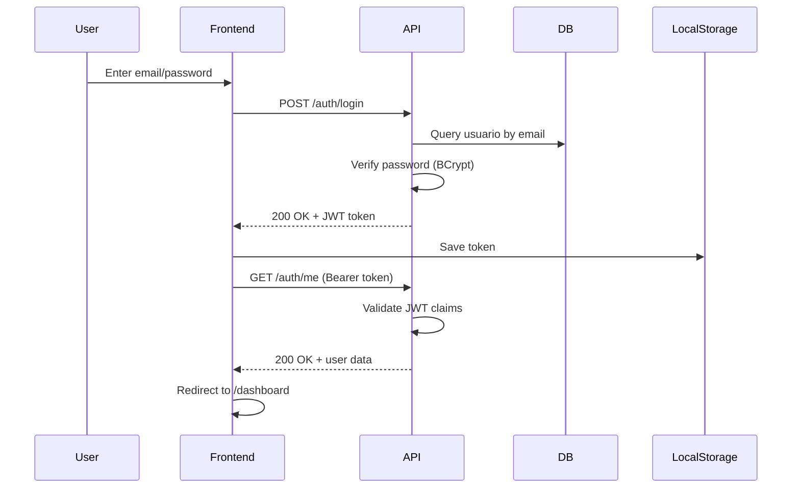
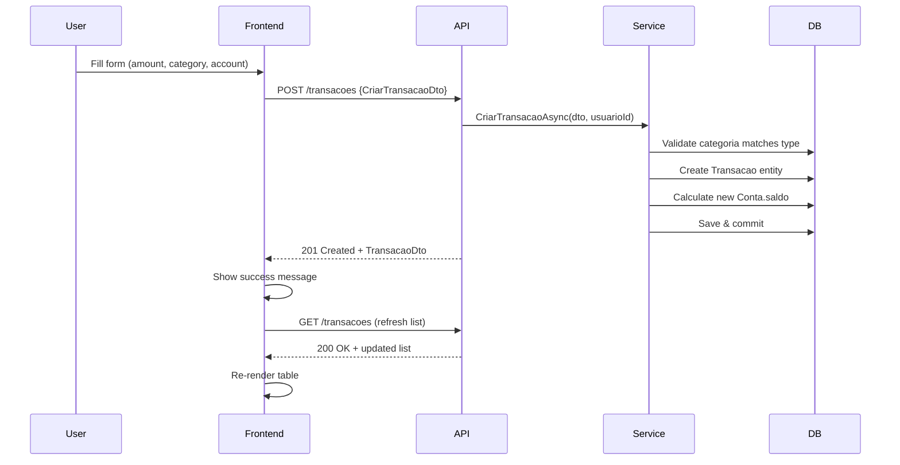
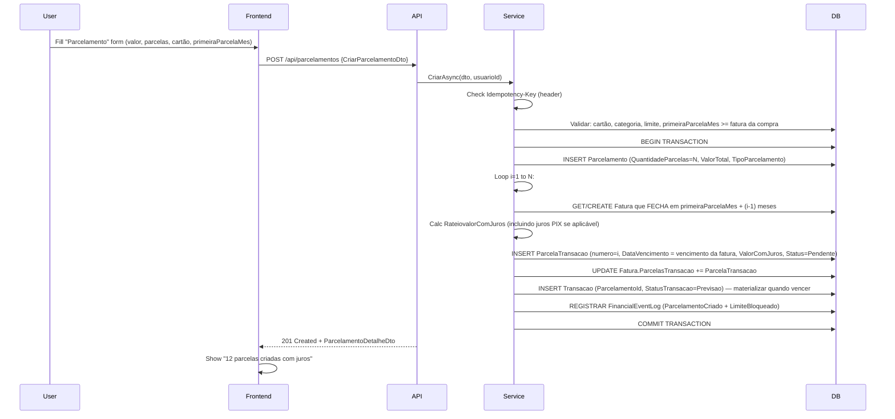
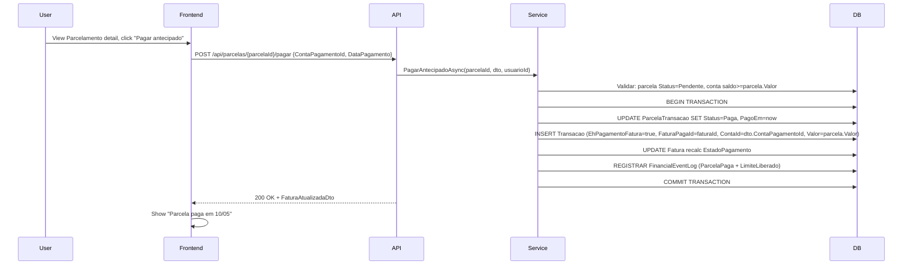
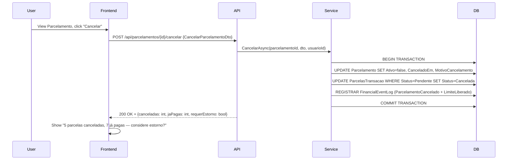
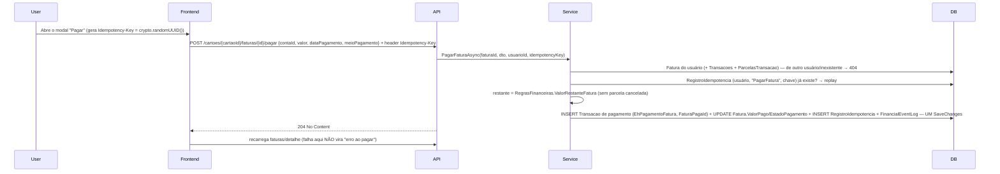
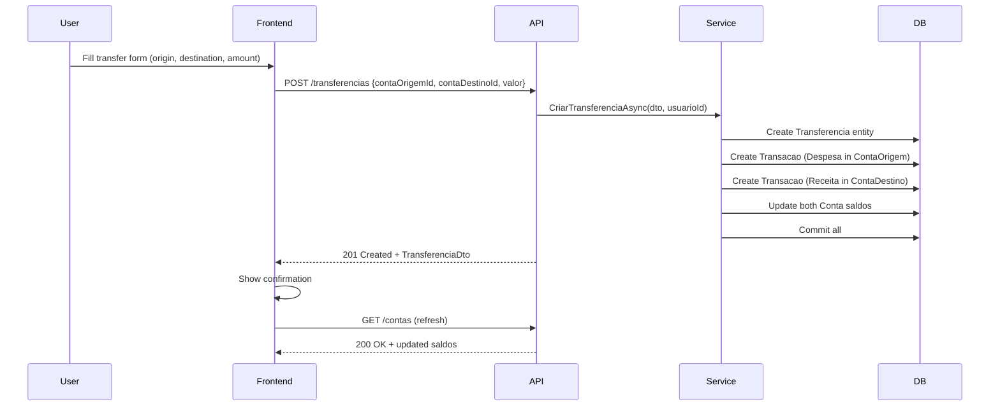
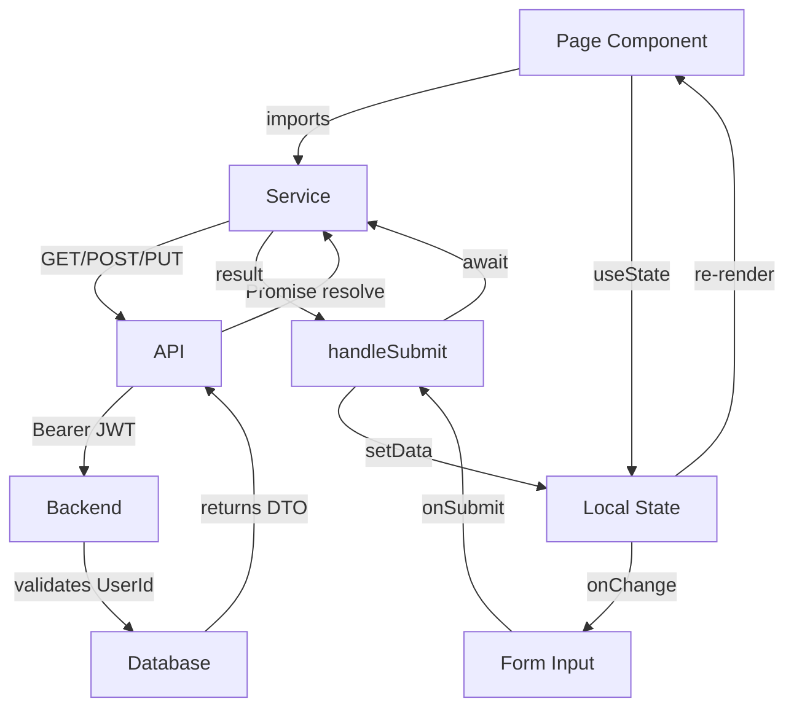
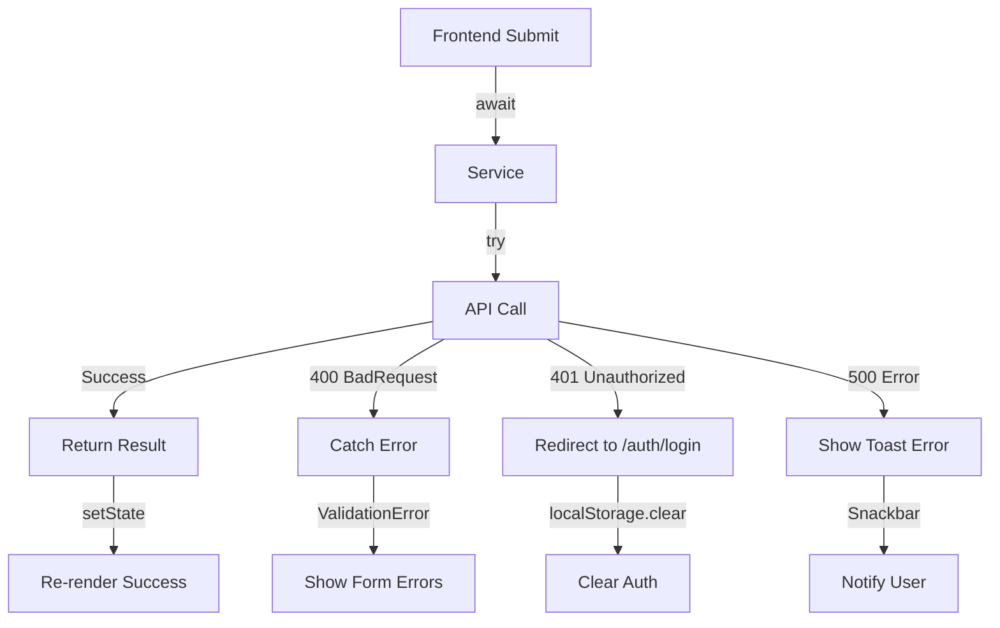
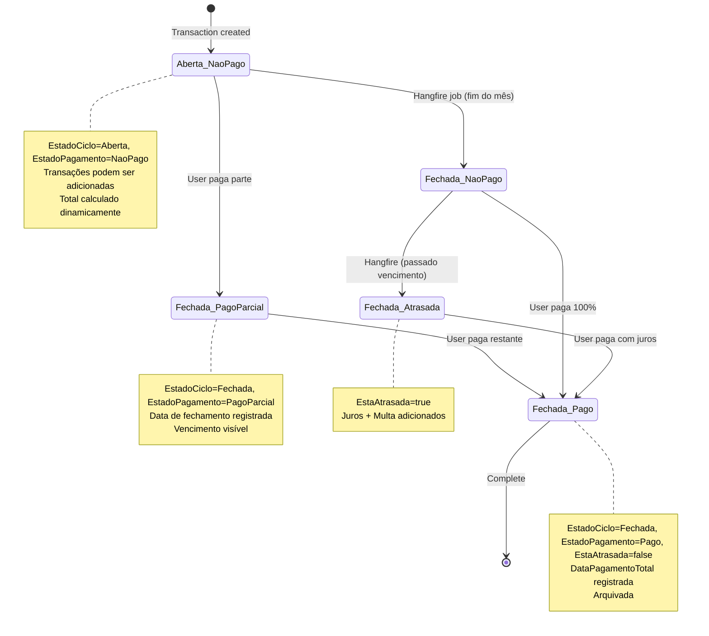

# Data Flow Diagrams

Visual representation of core business flows.

## 1. Authentication Flow



**JWT Structure:**
- **Header:** `{"alg":"HS256","typ":"JWT"}`
- **Payload:** `{"sub":"user-id","email":"user@email.com","name":"User","iat":...,"exp":...}`
- **Secret:** Configured in `appsettings.json`
- **Expiration:** 60 minutes

---

## 2. Create Transaction Flow (À Vista)



**Validation:**
- `Valor > 0`
- `CategoriaId` exists & matches `TipoTransacao`
- `ContaId` or `CartaoCreditoId` (exactly one)
- `Data` cannot be future date

---

## 3. Create Parcelamento (Flexible Installment) Flow — ETAPA 2



**Key Points (ETAPA 2):**
- `TipoParcelamento`: 0=CompraParcelada (à vista no cartão), 1=PIXCredito (com juros)
- `QuantidadeParcelas`: 2-36, flexível
- `primeiraParcelaMes` (yyyy-MM) = o mês em que **fecha** a fatura da 1ª parcela (o rótulo da fatura na tela Cartões: "Outubro de 2026 · 10/09–10/10"); não depende do dia da compra. Não pode ser antes da fatura em que a compra cai (a que fecha depois da `DataCompra`); o form sugere essa fatura e usa como mínimo do `PontesMonthInput`
- Parcela N → fatura que fecha em `primeiraParcelaMes + N-1`; `DataVencimento` da parcela = vencimento real dessa fatura (`FaturaService.DataNoCicloQueFechaEm` + `CalcularPeriodo`/`CalcularVencimento`)
- Cada ParcelaTransacao = 1 Fatura diferente
- Idempotência via `Idempotency-Key` header + `FinancialEventLogService`
- Limite bloqueado imediatamente (`LimiteBloqueado += ValorComJuros`)
- Juros PIX: simples (1.99%-11.99% a.m.)

---

## 3b. Pagar Parcela Antecipada — ETAPA 2



---

## 3c. Cancelar Parcelamento Inteiro — ETAPA 2



---

## OLD 3. Create Parcelada (Legacy — Removed in ETAPA 2)

```
DEPRECATED: Old system used Transacao.Parcelas + NumeroParcela.
Replaced by: Parcelamento + ParcelaTransacao (flexible, per-month parcelas).
```

---

## 4. Pagar Fatura Flow



**Regras:**
- `Idempotency-Key` **obrigatória** (sem ela → 400). Mesma chave + mesmos dados (conta, valor, data, meio) → 204 sem pagar de novo (replay vem antes do "já paga"). Mesma chave + outros dados, ou em outra fatura → 409. Tentativa que falha não gasta a chave.
- `0 < valor <= restante`; fatura `Pago` recusa (409).
- Concorrência: `Fatura.Versao` = `xmin`. Outro pagamento/operação na mesma fatura entre a leitura e o save → 409 `CONCURRENCY_CONFLICT`; corrida com a **mesma** chave (23505 no índice único ou `xmin`) → replay.
- Front: 4xx com mensagem vira **aviso** com a mensagem do servidor; no 409 o modal fecha e a fatura recarrega (reabrir gera chave nova).

---

## 5. Transferência Entre Contas Flow



**Implicit Transactions:**
```sql
-- Created automatically:
INSERT INTO transacoes (id, conta_id, tipo, valor, descricao, data)
  VALUES (uuid1, conta_origem_id, 1, 1000, 'Transferência saída', '2026-05-07');

INSERT INTO transacoes (id, conta_id, tipo, valor, descricao, data)
  VALUES (uuid2, conta_destino_id, 0, 1000, 'Transferência entrada', '2026-05-07');
```

---

## 6. Frontend Component Integration Flow



**Pattern:**
1. Component mounts → `useEffect(() => fetchData())`
2. User interacts → State updates
3. Submit handler → Calls service
4. Service uses axiosClient → sends request with JWT
5. Backend validates JWT → processes → returns
6. Service returns → Component updates state
7. State change → re-render

---

## 7. Saldo Dinâmico Calculation

**Not Stored:** Conta.Saldo is NOT a table column.

**Regra única (#269):** `RegrasFinanceiras` — saldo = Σ receitas − Σ despesas das transações `Ativo` + `Executado` da conta (inclui transferência, saldo inicial e pagamento de fatura; **exclui previsão** e excluídas). Agregado **no banco** numa query só pra todas as contas (`GROUP BY ContaId` + `SUM(CASE ...)`), filtrando pelo dono da conta. Consumidores (`ContasController` via `ContaService.ObterSaldosAsync`, `DashboardService`, `ParcelaTransacaoService`, `TransacaoService.ObterResumoPorContaAsync`) não recalculam na mão.

---

## 8. User Data Isolation

Every query filters by `UsuarioId`:

```csharp
// Correct ✓
var transacoes = await _context.Transacoes
    .Where(t => t.UsuarioId == usuarioId)
    .ToListAsync();

// Dangerous ✗ (missing filter)
var transacoes = await _context.Transacoes.ToListAsync();
```

**Rule:** `usuarioId` passed from Controller → Service → Repository queries

---

## 9. Error Handling Flow



**Interceptors (axiosClient.ts):**
1. **Request:** Injects JWT from localStorage
2. **Response Success:** Returns data
3. **Response Error 401:** Clears token & redirects to login
4. **Response Error 4xx/5xx:** Lets caller handle

---

## 10. Authentication + Authorization Matrix

| Endpoint | Auth | Scope | Notes |
|----------|------|-------|-------|
| `POST /auth/register` | ❌ No | Public | Anyone can register |
| `POST /auth/login` | ❌ No | Public | Public endpoint |
| `GET /auth/me` | ✅ Yes | User | Requires valid JWT |
| `GET /contas` | ✅ Yes | User | Filters by UsuarioId |
| `POST /contas` | ✅ Yes | User | Creates for current user |
| `PUT /contas/{id}` | ✅ Yes | User | Only own accounts |
| `DELETE /contas/{id}` | ✅ Yes | User | Only own accounts |
| `GET /transacoes` | ✅ Yes | User | Only own transactions |
| `POST /transacoes` | ✅ Yes | User | Creates for current user |

---

## 11. Estado de Fatura Transitions — ETAPA 3 (3 Orthogonal Flags)



**3 Orthogonal Flags:**
1. **EstadoCiclo:** `Aberta` (0) | `Fechada` (1)
   - Controls if new transactions can be added
2. **EstadoPagamento:** `NaoPago` (0) | `PagoParcial` (1) | `Pago` (2)
   - Calculated from sum of Transacoes + ParcelasTransacao pagas
3. **EstaAtrasada:** `false` | `true`
   - Set by FaturaAtrasoJob if DataVencimento passed without full payment

**No longer:** Single `Status` enum (legacy deleted in ETAPA 5b)

---

## Frontend ↔ Backend Contract (Types)

**Generated in frontend:** `src/types/` mirrors backend DTOs

**Example:**
```typescript
// Frontend type
interface TransacaoDto {
  id: string;
  descricao: string;
  valor: number;
  tipo: 0 | 1; // 0=Receita, 1=Despesa
  categoriaId?: string;
  contaId?: string;
  cartaoCreditoId?: string;
  data: string; // ISO datetime
}

// Backend DTO
public class TransacaoDto {
  public Guid Id { get; set; }
  public string Descricao { get; set; }
  public decimal Valor { get; set; }
  public int Tipo { get; set; }
  // ...
}
```

**Keep them in sync!**
