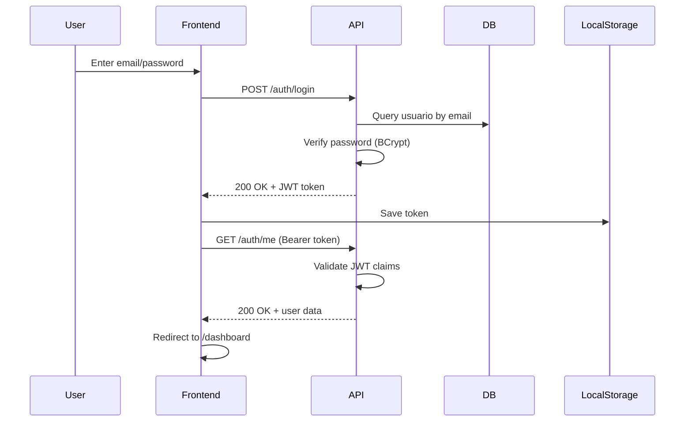
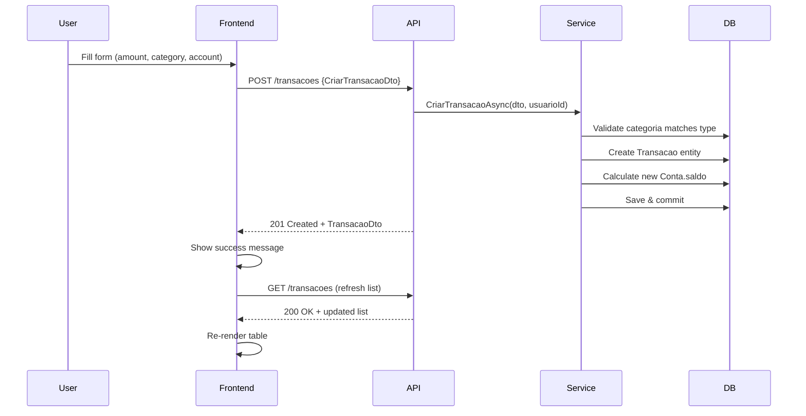
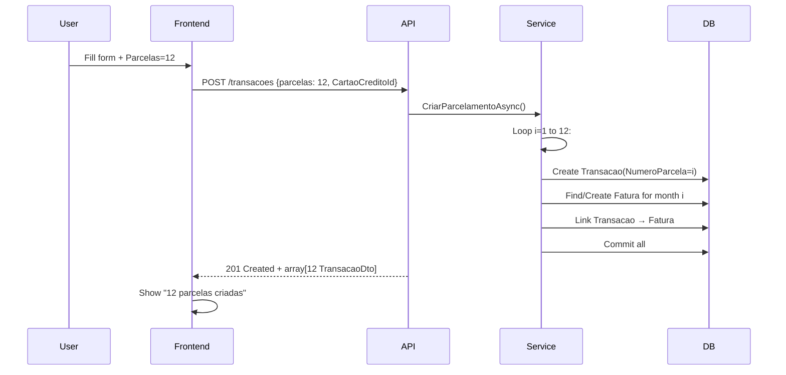
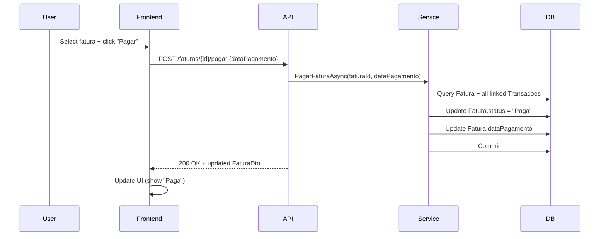
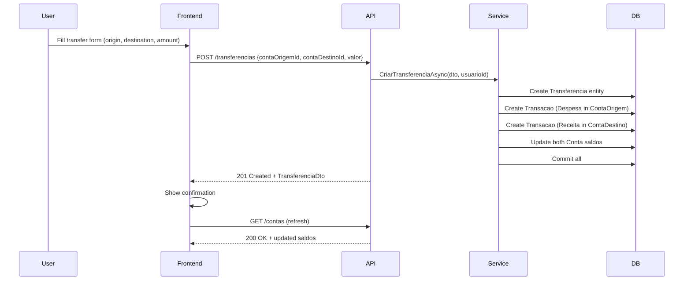
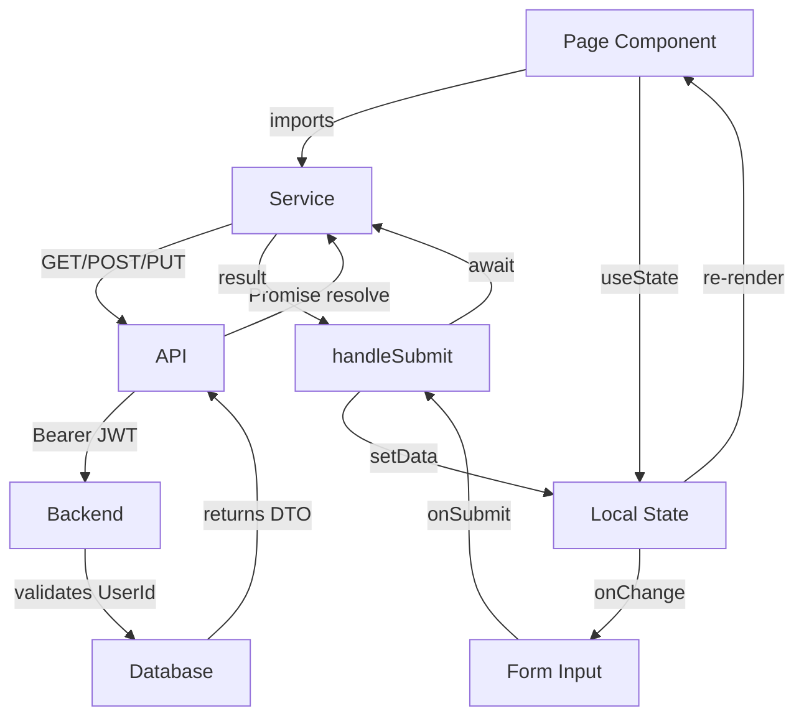
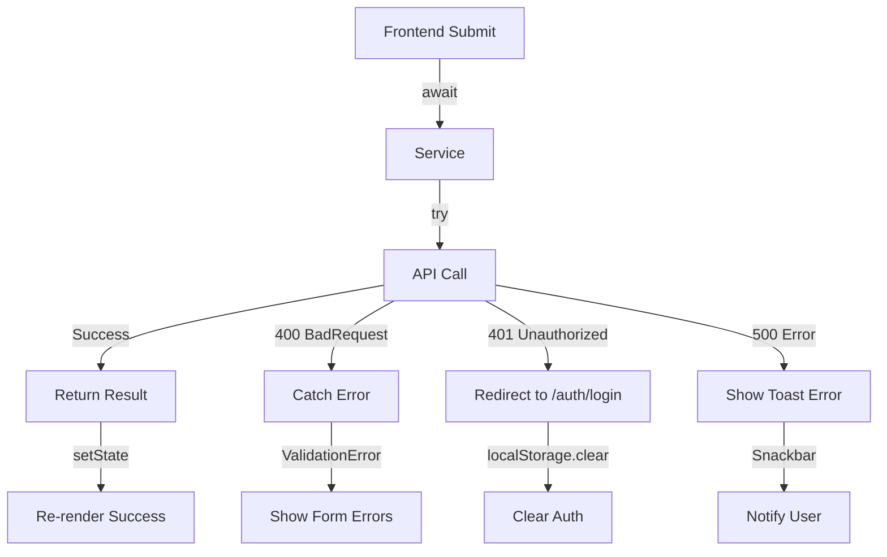
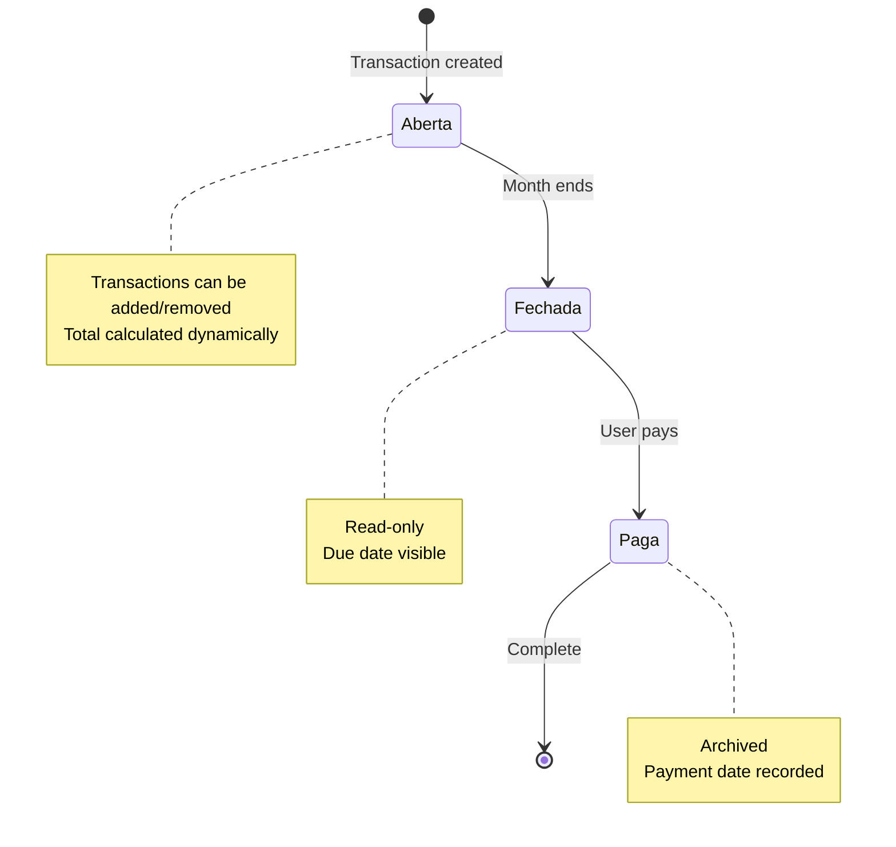

# Data Flow Diagrams

Visual representation of core business flows.

## 1. Authentication Flow



**JWT Structure:**
- **Header:** `{"alg":"HS256","typ":"JWT"}`
- **Payload:** `{"sub":"user-id","email":"user@email.com","name":"User","iat":...,"exp":...}`
- **Secret:** Configured in `appsettings.json`
- **Expiration:** 60 minutes

---

## 2. Create Transaction Flow (À Vista)



**Validation:**
- `Valor > 0`
- `CategoriaId` exists & matches `TipoTransacao`
- `ContaId` or `CartaoCreditoId` (exactly one)
- `Data` cannot be future date

---

## 3. Create Parcelada (Installment) Flow



**Key Points:**
- `Parcelas.HasValue && Parcelas > 1` triggers parcelamento
- Each `Transacao` has unique `NumeroParcela` (1..N)
- `Fatura` auto-created for each month
- Status starts as "Aberta"

---

## 4. Pagar Fatura Flow



**Behavior:**
- Only `Status=Aberta` can be paid
- Auto-updates linked `Transacoes` implicitly

---

## 5. Transferência Entre Contas Flow



**Implicit Transactions:**
```sql
-- Created automatically:
INSERT INTO transacoes (id, conta_id, tipo, valor, descricao, data)
  VALUES (uuid1, conta_origem_id, 1, 1000, 'Transferência saída', '2026-05-07');

INSERT INTO transacoes (id, conta_id, tipo, valor, descricao, data)
  VALUES (uuid2, conta_destino_id, 0, 1000, 'Transferência entrada', '2026-05-07');
```

---

## 6. Frontend Component Integration Flow



**Pattern:**
1. Component mounts → `useEffect(() => fetchData())`
2. User interacts → State updates
3. Submit handler → Calls service
4. Service uses axiosClient → sends request with JWT
5. Backend validates JWT → processes → returns
6. Service returns → Component updates state
7. State change → re-render

---

## 7. Saldo Dinâmico Calculation

**Not Stored:** Conta.Saldo is NOT a table column.

**Calculated On-the-fly:**
```csharp
var saldo = transacoes
    .Where(t => t.ContaId == contaId)
    .GroupBy(t => t.Tipo)
    .ToDictionary(g => g.Key, g => g.Sum(t => t.Valor));

var receitas = saldo.GetValueOrDefault(TipoTransacao.Receita, 0);
var despesas = saldo.GetValueOrDefault(TipoTransacao.Despesa, 0);
var saldoFinal = receitas - despesas;
```

**Performance Note:** Consider indexing `transacoes(conta_id, tipo)` for large datasets.

---

## 8. User Data Isolation

Every query filters by `UsuarioId`:

```csharp
// Correct ✓
var transacoes = await _context.Transacoes
    .Where(t => t.UsuarioId == usuarioId)
    .ToListAsync();

// Dangerous ✗ (missing filter)
var transacoes = await _context.Transacoes.ToListAsync();
```

**Rule:** `usuarioId` passed from Controller → Service → Repository queries

---

## 9. Error Handling Flow



**Interceptors (axiosClient.ts):**
1. **Request:** Injects JWT from localStorage
2. **Response Success:** Returns data
3. **Response Error 401:** Clears token & redirects to login
4. **Response Error 4xx/5xx:** Lets caller handle

---

## 10. Authentication + Authorization Matrix

| Endpoint | Auth | Scope | Notes |
|----------|------|-------|-------|
| `POST /auth/register` | ❌ No | Public | Anyone can register |
| `POST /auth/login` | ❌ No | Public | Public endpoint |
| `GET /auth/me` | ✅ Yes | User | Requires valid JWT |
| `GET /contas` | ✅ Yes | User | Filters by UsuarioId |
| `POST /contas` | ✅ Yes | User | Creates for current user |
| `PUT /contas/{id}` | ✅ Yes | User | Only own accounts |
| `DELETE /contas/{id}` | ✅ Yes | User | Only own accounts |
| `GET /transacoes` | ✅ Yes | User | Only own transactions |
| `POST /transacoes` | ✅ Yes | User | Creates for current user |

---

## 11. Estado de Fatura Transitions



---

## Frontend ↔ Backend Contract (Types)

**Generated in frontend:** `src/types/` mirrors backend DTOs

**Example:**
```typescript
// Frontend type
interface TransacaoDto {
  id: string;
  descricao: string;
  valor: number;
  tipo: 0 | 1; // 0=Receita, 1=Despesa
  categoriaId?: string;
  contaId?: string;
  cartaoCreditoId?: string;
  data: string; // ISO datetime
}

// Backend DTO
public class TransacaoDto {
  public Guid Id { get; set; }
  public string Descricao { get; set; }
  public decimal Valor { get; set; }
  public int Tipo { get; set; }
  // ...
}
```

**Keep them in sync!**
